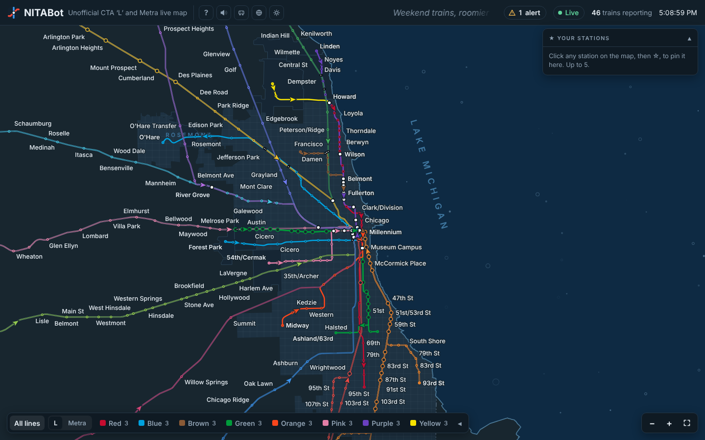

# NITABot

**Every CTA 'L' and Metra train in Chicagoland, live, on one map.**

👉 **[Open NITABot](https://evan-dawkins.github.io/nitabot/)** — works in any browser, on your phone or computer. Nothing to install.

## What it is

NITABot is a live map of Chicago's trains. Each little arrow is a real train, drawn where it last reported its position. The L and Metra share one map, drawn to real geography: start in Chicago, then zoom out to see Metra stretch from Kenosha to University Park.

It's made to be fun to leave running, like a fish tank on a second screen, and handy when you actually need a train.

## What you can do

- **Watch trains move.** Drag to look around, scroll or pinch to zoom.
- **Tap a train** to see where it's going and its next stops. Hit **Follow** to ride along with it.
- **Tap a station** for the next trains. Metra's downtown stations show a departure board.
- **Save your stations.** Tap ☆ on up to 5 stations and they stay on your board.
- **Check service alerts** for CTA and Metra, sorted by type (delays, elevators, planned work...). "Show on map" takes you to the station or line.
- **See one line at a time** using the line bar at the bottom.
- **Spot transfers.** White markers show where you can change trains, including walks between nearby stations.
- **Leave it alone** for a couple of minutes and it picks a train and rides along, with a voice checking in now and then.

## Extras

The buttons by the title:

- **Sound:** brown noise, water, or sonar (a radar sweep that pings with each update)
- **Cute trains:** little train cars instead of arrows
- **Satellite:** real aerial imagery under the map
- **Light or dark** mode
- **?** opens the welcome guide again

## Good to know

- Positions update about every 30 seconds, so a train jumps forward a bit at a time. If a train's location looks wrong, NITABot holds it where it last made sense instead of guessing.
- A grey train hasn't reported in a few minutes.
- If Metra's data stops coming in, a banner tells you and how long it's been. The L keeps working on its own.
- The O'Hare airport train is shown for fun, but it's simulated (there's no live data for it), and it's labelled that way.

## The fine print

NITABot is an unofficial personal project made for fun and is not affiliated with NITA. It isn't affiliated with the CTA, Metra or the RTA either. Train positions and times come from CTA's public Train Tracker data and Metra's public data feeds. Always check official sources before you travel.

Map data: Chicago Transit Authority; Metra; US Census Bureau; OpenStreetMap contributors; USDA and USGS (satellite imagery).

Made by Evan Dawkins. How it's built and tested: [technical notes](docs/2026-10-25-technical-notes.md).
