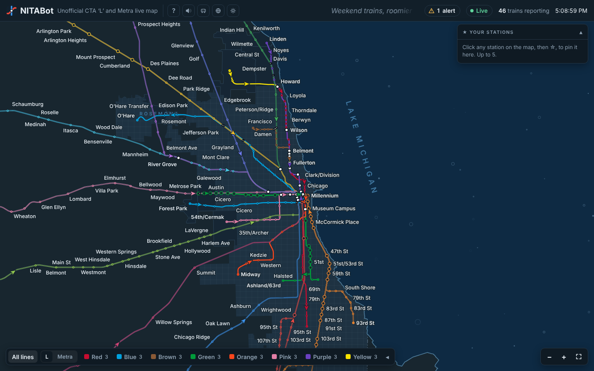
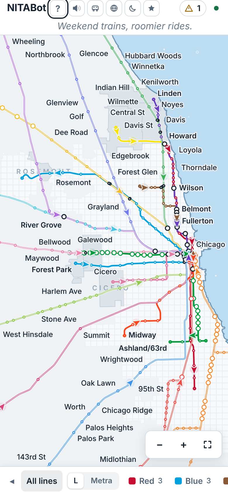

# NITABot

Every CTA 'L' and Metra train in Chicagoland, live, on one map.

### [Open NITABot](https://evan-dawkins.github.io/nitabot/)

It runs in any browser, on a phone or a computer. There's nothing to install and no account, and it's free.

  
  

## About

NITABot started as two separate projects: MetraBot, a live Metra map, and CTABot, a live map of the 'L'. Putting them on one real map shows how the two systems fit together across the city and suburbs. Start downtown, then zoom out and watch Metra stretch from Kenosha to University Park while the 'L' fades into the background.

Each arrow is a real train, drawn where it last reported. If a train's data stops making sense, NITABot holds it in place instead of guessing where it went.

I built it to leave running on a second screen, like a fish tank, and to be handy when you actually need to catch a train.

## What you can do

- Drag to look around, and scroll or pinch to zoom.
- Tap a train to see where it's headed and its next stops. Hit **Follow** to ride along.
- Tap a station for its next trains. Metra's downtown terminals show a full departure board.
- Tap ☆ on up to 5 stations to keep them on your board.
- Check CTA and Metra service alerts, sorted into delays, disruptions, elevators and planned work. **Show on map** jumps to the station or line.
- Pick one line at a time from the line bar at the bottom.
- White markers show where you can change trains, and dotted paths show a short walk between stations.
- Leave it alone for a couple of minutes and it picks a train and rides along, with a voice checking in now and then.

## Extras

The View button at the top opens the fun settings:

| Setting | What it does |
| --- | --- |
| Sound | Brown noise, water, or sonar (a radar sweep that pings with each update) |
| Cute trains | Little train cars instead of arrows |
| Satellite | Real aerial imagery under the map |
| Dark mode | Light or dark map |

The ? button opens the welcome guide and the map key.

## Good to know

- Positions update about every 30 seconds. Trains glide between real reports and never run ahead of the data.
- A grey train hasn't reported in a few minutes.
- If Metra's data stops, a banner says so and how long it's been. The 'L' keeps working on its own.
- The O'Hare airport train is simulated, because there's no live data for it, and it's labelled that way.
- Check official sources before you travel: [CTA](https://www.transitchicago.com/) and [Metra](https://metra.com/).

## The fine print

NITABot is an unofficial personal project made for fun and is not affiliated with NITA. It isn't affiliated with the CTA, Metra or the RTA either. Train positions and times come from CTA's public Train Tracker data and Metra's public data feeds, provided as-is.

Map data: Chicago Transit Authority; Metra; US Census Bureau; OpenStreetMap contributors; USDA and USGS (satellite imagery).

Made by Evan Dawkins. The [technical notes](docs/2026-10-25-technical-notes.md) explain how it works.
