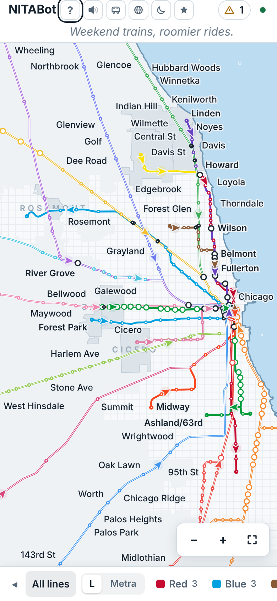

# NITABot

**Every CTA 'L' and Metra train in Chicagoland, live, on one map.**

### 👉 [Open NITABot](https://evan-dawkins.github.io/nitabot/)

Works in any browser, on your phone or your computer. Nothing to install, no account, free.

  
  

## About

NITABot started as two separate projects: **MetraBot**, a live Metra map, and **CTABot**, a live map of the 'L'. NITABot brings them together on one real map, so you can see how the two systems actually fit across the city and suburbs: start downtown, then zoom out and watch Metra stretch from Kenosha to University Park while the 'L' fades into the background.

Each arrow is a real train, drawn where it last reported. Nothing is made up: if a train's data stops making sense, NITABot holds it in place instead of guessing.

It's built to be fun to leave running, like a fish tank on a second screen, and handy when you actually need to catch a train.

## What you can do

- **Watch trains move.** Drag to look around, scroll or pinch to zoom.
- **Tap a train** to see where it's headed and its next stops. Hit **Follow** to ride along.
- **Tap a station** for its next trains. Metra's downtown terminals show a full departure board.
- **Save your stations.** Tap ☆ on up to 5 and they stay on your board.
- **Check service alerts** for CTA and Metra, sorted by type: delays, disruptions, elevators, planned work. **Show on map** jumps to the station or line.
- **See one line at a time** from the line bar at the bottom.
- **Find transfers.** White markers show where you can change trains; dotted paths show a short walk between stations.
- **Leave it alone** for a couple of minutes and it picks a train and rides along, with a voice checking in now and then.

## Extras

The buttons next to the title:

| Button | What it does |
| --- | --- |
| Sound | Brown noise, water, or sonar (a radar sweep that pings with each update) |
| Cute trains | Little train cars instead of arrows |
| Satellite | Real aerial imagery under the map |
| Sun / moon | Light or dark mode |
| ? | The welcome guide and map key |

## Good to know

- **Positions update about every 30 seconds.** Trains glide between real reports and never run ahead of the data.
- **A grey train** hasn't reported in a few minutes.
- **If Metra's data stops**, a banner says so and how long it's been. The 'L' keeps working on its own.
- **The O'Hare airport train** is simulated (there's no live data for it), and it's labelled that way.
- **Always check official sources** before you travel: [CTA](https://www.transitchicago.com/) and [Metra](https://metra.com/).

## The fine print

NITABot is an unofficial personal project made for fun and is not affiliated with NITA. It isn't affiliated with the CTA, Metra or the RTA either. Train positions and times come from CTA's public Train Tracker data and Metra's public data feeds, provided as-is.

Map data: Chicago Transit Authority; Metra; US Census Bureau; OpenStreetMap contributors; USDA and USGS (satellite imagery).

---

Made by Evan Dawkins. Curious how it works? See the [technical notes](docs/2026-10-25-technical-notes.md).
